<a href="https://www.joaovictord.dev">
  <picture>
    <source media="(prefers-color-scheme: dark)" srcset="./assets/banner-dark.svg">
    
  </picture>
</a>

### Hey, I'm João 👋

Software engineer from Fortaleza, Brazil 🇧🇷 (yes, the beaches are that good 🏖️). I've been building web stuff people use every day for 5+ years, and I'm the person who asks *"ok, but what if the request fails?"* in every review.

- 🛡️ Building the console for **[Quor](https://www.joaovictord.dev/projects/cmrcp63rj0bp207kiddusv3op)** at Getup: hardened container images, rebuilt as fixes land
- 🤖 Side quest: **[agents](https://github.com/joaovictor3g/agents)**, a CLI that runs a whole team of AI coding agents on one repo, each in its own worktree. `brew install joaovictor3g/tap/agents`
- 🧪 Cooking up **[fizdemo](https://fizdemo.app)** (your app's screens → a narrated demo video) and **[MockPrep](https://mockprep.joaovictord.dev)** (mock interviews you can replay). Waitlists are open!
- ✍️ Writing about shipping with AI agents on **[the blog](https://www.joaovictord.dev/blog)**
- 🐛 Favorite kind of bug: the one that typechecks, lints, passes CI… and still breaks the page

### 🚢 Things I've shipped

- 🛡️ **[Quor](https://www.joaovictord.dev/projects/cmrcp63rj0bp207kiddusv3op)**: browse a catalog of hardened images, dig into each one's security data, manage registry access
- 📊 **[Big Data Social](https://www.joaovictord.dev/projects/cmrdszk7h02uf07lozg0jbw52)**: Ceará's public dashboards and maps for social programs that reach hundreds of thousands of families
- 🌊 **[SeatechWorld](https://www.joaovictord.dev/projects/cmjw41x9g0x2607kmdrw4881j)**: a software house's site, with a CMS blog and leads from forms, WhatsApp, email and newsletter

### 📝 Fresh from the blog

- [The model can't see the page](https://www.joaovictord.dev/blog/the-model-cant-see-the-page) 👀
- [Sending an email is the easy part](https://www.joaovictord.dev/blog/sending-an-email-is-the-easy-part) 📬
- [Migrating an app from Angular to React](https://www.joaovictord.dev/blog/migrating-an-app-from-angular-to-react) 🔁
- [From Claude Code to T3 Code, without leaving Claude](https://www.joaovictord.dev/blog/from-claude-code-to-t3-code) 📱

### ✅ How I work

- [x] Check the page, not just the tests
- [x] Accessibility is part of done
- [x] Sweat the unhappy path: retries, bounces, expired links
- [x] Big changes, small safe steps

### 🧰 Stack I work in

<picture>
  <source media="(prefers-color-scheme: dark)" srcset="https://skillicons.dev/icons?i=ts%2Creact%2Cnextjs%2Cnodejs%2Ctailwind%2Cgraphql%2Cprisma%2Cvite%2Cgo&theme=dark">
  
</picture>

### 💬 Say hi

   

🥚 psst: the site hides a few easter eggs. [Start here](https://www.joaovictord.dev/blog/balloons-easter-egg-1), or come back in late October 🎃

<!-- Reading the source? Hi! You'd like the site. -->
